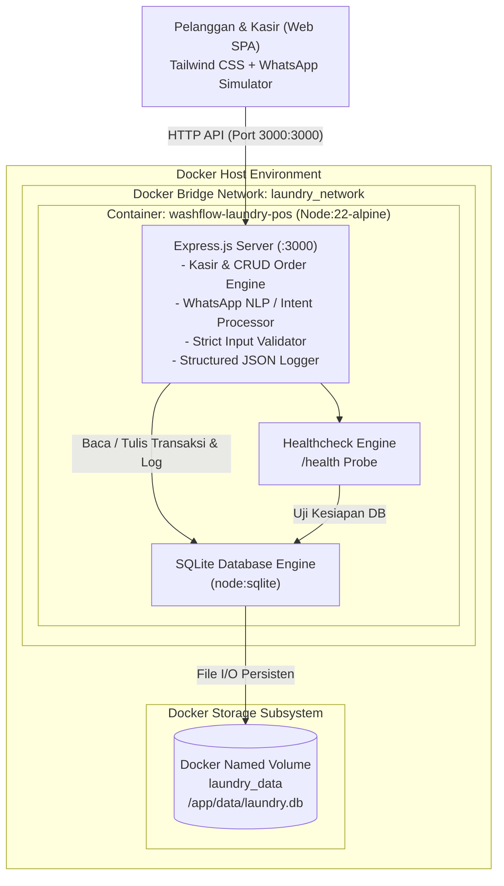
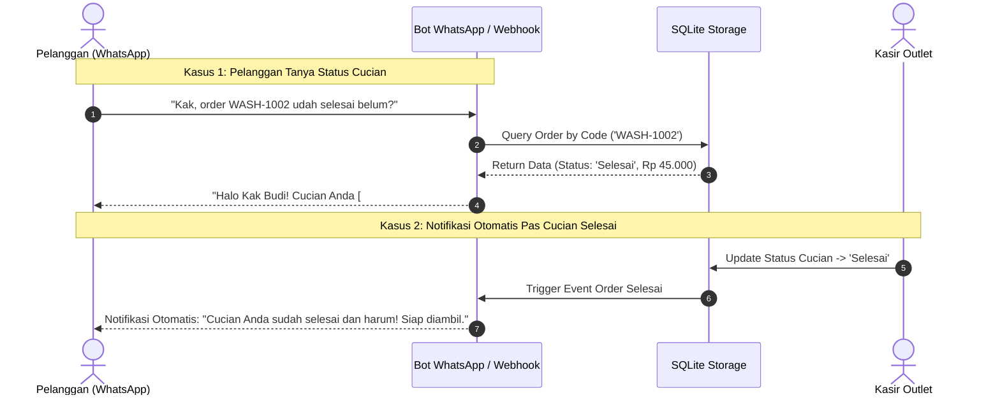

# WashFlow Cloud: System Architecture Documentation

Dokumen ini menjelaskan arsitektur sistem, containerisasi Docker, persistent storage, alur otomatisasi WhatsApp, dan penanganan gangguan pada platform **WashFlow Cloud Laundry POS**.

---

## 1. Diagram Arsitektur 3-Tier



---

## 2. Alur Pesan & Otomatisasi Bot WhatsApp



---

## 3. Persistensi Data Docker Volume

```text
+-------------------------------------------------------------------------+
| HOST OPERATING SYSTEM                                                   |
|                                                                         |
|  [Port 3000]                                                            |
|       |                                                                 |
|       v                                                                 |
|  +-------------------------------------------------------------------+  |
|  | DOCKER BRIDGE NETWORK (laundry_network)                           |  |
|  |                                                                   |  |
|  |   CONTAINER: washflow-laundry-pos                                 |  |
|  |   +-----------------------------------------------------------+   |  |
|  |   | Base: node:22-alpine                                      |   |  |
|  |   | User: node (Non-root Least Privilege)                     |   |  |
|  |   | Mount: /app/data <===================================+    |   |  |
|  |   +------------------------------------------------------|----+   |  |
|  +----------------------------------------------------------|--------+  |
|                                                             |           |
|                                                             v           |
|  NAMED VOLUME: laundry_data ================================>+           |
|  (Menyimpan file database /app/data/laundry.db di host OS)              |
|  Data tetap utuh saat:                                                  |
|    - docker compose restart                                             |
|    - docker compose down && docker compose up                           |
|    - Container crash / failure                                          |
+-------------------------------------------------------------------------+
```
